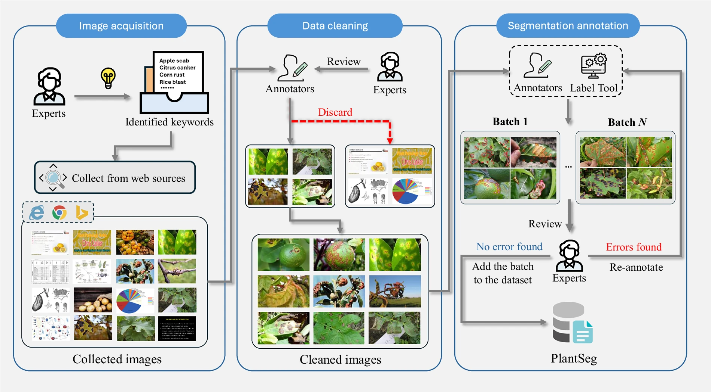

# PlantSeg: A Large-Scale In-the-wild Dataset for Plant Disease Segmentation


The paper has been accepted for publication in **Scientific Data**.

## Introduction
We established a large-scale plant disease segmentation dataset named PlantSeg. PlantSeg comprises more than 7,774 images of plant diseases from various environments, each annotated with its corresponding segmentation label for diseased parts. To the best of our knowledge, PlantSeg is the largest plant disease segmentation dataset containing in-the-wild images. Our dataset enables researchers to evaluate their models and provides a valid foundation for the development and benchmarking of plant disease segmentation algorithms.

## Curation of our dataset
The curation process of the PlantSeg dataset involves three main steps: image acquisition, data cleaning, and annotation. In the image acquisition stage, images were collected from various internet sources using identified keywords and then stored according to their categories. During the data cleaning phase, incorrect images were identified and removed. For the segmentation annotation process, annotators utilized LabelMe to annotate the cleaned images. These annotations were subsequently reviewed by experts and saved in JSON files.
<div align="center">
  
</div>


## Preparation
### 1. Clone the repo
```bash
git clone https://github.com/tqwei05/PlantSeg.git
cd PlantSeg
```
### 2. Prepare the data
PlantSeg is accessible through [Zenodo](https://doi.org/10.5281/zenodo.17719108). After downloading, put PlantSeg under the "data" folder.


### 3. Environment setting
Follow [MMSegmentation](https://github.com/open-mmlab/mmsegmentation/blob/main/docs/en/get_started.md#installation) to build the environment.


## Running
```python
sh run.sh
```


##  Baseline Results


Method | Backbone | Parameters ↓ | mIoU(%) ↑ | mAcc(%) ↑
--- | --- | --- | --- | ---
**CNN-based Methods** | | | |
MobileNetV3 | — | 5M | 10.22 | 17.15
DeepLabv3 | ResNet-50 | 42M | 17.24 | 37.95
DeepLabv3 | ResNet-101 | 61M | 20.72 | 40.63
PSPNet | ResNet-50 | 47M | 21.44 | 36.28
PSPNet | ResNet-101 | 66M | 22.81 | 39.00
DeepLabv3+ | ResNet-50 | 44M | 25.08 | 40.66
DeepLabv3+ | ResNet-101 | 63M | 27.18 | 42.29
CCNet | ResNet-50 | 48M | 27.12 | 36.62
CCNet | ResNet-101 | 67M | 30.15 | 39.98
**Transformer-based Methods** | | | |
SegFormer | MiT-B5 | 85M | 26.28 | 39.57
BEiT | BEiT-B | 86M | 24.77 | 38.83
BEiT | BEiT-L | 307M | 27.60 | 43.49
SAN | ViT-B/16 | 158M | 34.79 | 50.19
SAN | ViT-L/14 | 437M | 36.91 | 52.81
UPerNet | Swin-B | 120M | 38.67 | 53.44
UPerNet | Swin-L | 232M | 42.36 | 56.67
**Hybrid Methods** | | | |
SegNeXt | MSCAN-B | 28M | 42.05 | 56.30
SegNeXt | MSCAN-L | 49M | 44.52 | 59.95
ConvNeXt | ConvNeXt-B | 89M | 40.69 | 52.72
ConvNeXt | ConvNeXt-L | 121M | **46.24** | **59.97**

## Paper
[PlantSeg: A Large-Scale In-the-wild Dataset for Plant Disease Segmentation](https://www.nature.com/articles/s41597-025-06513-4)

## Citation
If you find our work useful, please cite as follows.

```BibTeX
@article{wei2026plantseg,
  title={A large-scale in-the-wild dataset for plant disease segmentation},
  author={Wei, Tianqi and Chen, Zhi and Yu, Xin and Chapman, Scott and Melloy, Paul and Huang, Zi},
  journal={Scientific Data},
  volume={13},
  number={1},
  pages={205},
  year={2026},
  publisher={Nature Publishing Group UK, London}
}
```


## Acknowledgments

Our code is based on [MMSegmentation](https://github.com/open-mmlab/mmsegmentation). We appreciate their wonderful work.


